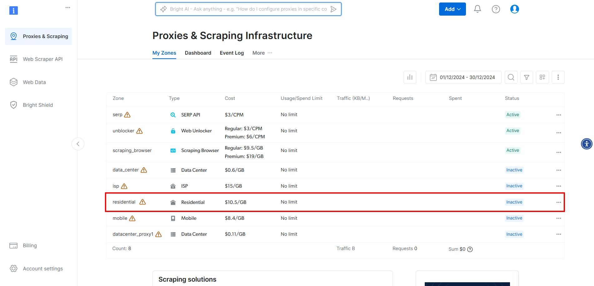
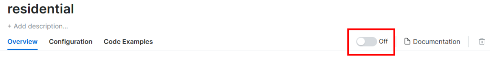
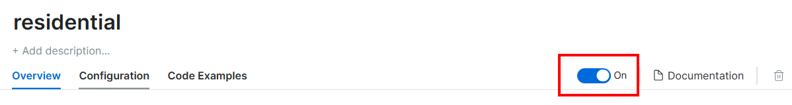
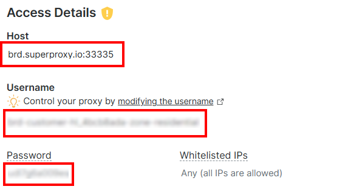

# 将 CloudScraper 与代理结合使用

[](https://www.bright.cn/) 

本指南介绍如何设置 CloudScraper 代理集成、轮换 IP，以及如何使用身份验证代理实现无缝抓取。

- [什么是 CloudScraper？](#关于-cloudscraper)
- [为什么要将代理与 CloudScraper 结合使用？](#为什么要将代理与-cloudscraper-结合使用)
- [为 CloudScraper 设置代理](#为-cloudscraper-设置代理)
- [实现代理轮换](#实现代理轮换)
- [在 CloudScraper 中使用身份验证代理](#在-cloudscraper-中使用身份验证代理)
- [在 CloudScraper 中集成高级代理](#在-cloudscraper-中集成高级代理)
- [总结](#总结)

## 关于 CloudScraper

[CloudScraper](https://github.com/VeNoMouS/cloudscraper) 是一个 Python 模块，旨在绕过 Cloudflare 的反机器人页面（通常称为“I'm Under Attack Mode”，简称 IUAM）。它在底层使用 Requests 实现，后者是最受欢迎的 Python HTTP 客户端之一。

## 为什么要将代理与 CloudScraper 结合使用？

如果你发送过多请求或触发更复杂且难以绕过的防御机制，Cloudflare 可能会封禁你的 IP。将代理与 CloudScraper 结合起来抓取由 Cloudflare 托管的网站，可以带来两大优势：

- **增强安全性和匿名性**：通过代理路由请求，可以隐藏你的真实身份，降低被检测到的风险。
- **避免封禁和中断**：代理让你能够动态轮换 IP 地址，从而帮助绕过封禁和速率限制。

## 为 CloudScraper 设置代理

### 步骤 1：安装 CloudScraper

安装 `cloudscraper` pip 软件包：

```bash
pip install -U cloudscraper
```

`-U` 选项可确保你获取该软件包的最新版本，其中包含针对 Cloudflare 反机器人引擎的最新绕过方案。

### 步骤 2：初始化 CloudScraper

导入 CloudScraper：

```python
import cloudscraper
```

使用 `create_scraper()` 方法创建 CloudScraper 实例：

```python
scraper = cloudscraper.create_scraper()
```

`scraper` 对象的工作方式与 `requests` 库中的 `Session` 对象类似。具体而言，它允许你在绕过 Cloudflare 反机器人措施的同时发送 HTTP 请求。

### 步骤 3：集成代理

定义一个 `proxies` 字典，并按如下方式将其传递给 `get()` 方法：

```python
proxies = {
    "http": "<YOUR_HTTP_PROXY_URL>",
    "https": "<YOUR_HTTPS_PROXY_URL>"
}

# Perform a request through the specified proxy
response = scraper.get("<YOUR_TARGET_URL>", proxies=proxies)
```

`get()` 方法中的 `proxies` 参数会向下传递给 Requests。这样，HTTP 客户端便可根据目标 URL 的协议，通过指定的 HTTP 或 HTTPS 代理服务器路由请求。

### 步骤 4：测试 CloudScraper 代理集成设置

为了演示，我们将请求 HTTPBin 项目的 `/ip` 端点。该端点会返回调用方的 IP 地址。如果一切按预期运行，响应中应显示代理服务器的 IP 地址。

假设代理服务器的 URL 为 `http://202.159.35.121:443`，脚本代码如下：

```python
import cloudscraper

# Create a CloudScraper instance
scraper = cloudscraper.create_scraper()

# Specify your proxy
proxies = {
    "http": "http://202.159.35.121:443",
    "https": "http://202.159.35.121:443"
}

# Make a request through the proxy
response = scraper.get("https://httpbin.org/ip", proxies=proxies)

# Print the response from the "/ip" endpoint
print(response.text)
```

你应该会看到类似以下内容的响应：

```json
{
    "origin": "202.159.35.121"
}
```

响应中的 IP 与代理服务器的 IP 一致，符合预期。

> **注意**：\
> 免费代理服务器通常存活时间很短。测试脚本时，最好为代理获取一个新的 IP 地址。

## 实现代理轮换

从可靠的提供商处获取代理列表，并将其存储在数组中：

```python
proxy_list = [
    {"http": "<YOUR_PROXY_URL_1>", "https": "<YOUR_PROXY_URL_1>"},
    # ...
    {"http": "<YOUR_PROXY_URL_n>", "https": "<YOUR_PROXY_URL_n>"},
]
```

接下来，使用 `random.choice()` 方法从列表中随机选择一个代理：

```python
import random

random_proxy = random.choice(proxy_list)
```

在 `get()` 请求中设置随机选中的代理：

```python
response = scraper.get("<YOUR_TARGET_URL>", proxies=random_proxy)
```

如果所有设置均正确，每次运行请求时都会使用列表中的不同代理。完整代码如下：

```python
import cloudscraper
import random

# Create a Cloudscraper instance
scraper = cloudscraper.create_scraper()

# List of proxy URLs (replace with actual proxy URLs)
proxy_list = [
    {"http": "<YOUR_PROXY_URL_1>", "https": "<YOUR_PROXY_URL_1>"},
    # ...
    {"http": "<YOUR_PROXY_URL_n>", "https": "<YOUR_PROXY_URL_n>"},
]

# Randomly select a proxy from the list
random_proxy = random.choice(proxy_list)

# Make a request using the randomly selected proxy
# (replace with the actual target URL)
response = scraper.get("<YOUR_TARGET_URL>", proxies=random_proxy)
```

## 在 CloudScraper 中使用身份验证代理

要在 CloudScraper 中对代理进行身份验证，请直接在代理 URL 中加入所需凭据。用户名和密码身份验证的格式如下：

`<PROXY_PROTOCOL>://<YOUR_USERNAME>:<YOUR_PASSWORD>@<PROXY_IP_ADDRESS>:<PROXY_PORT>`
    
使用该格式时，CloudScraper 代理配置如下所示：

```python
import cloudscraper

# Create a Cloudscraper instance
scraper = cloudscraper.create_scraper()  

# Define your authenticated proxy
proxies = {
   "http": "<PROXY_PROTOCOL>://<YOUR_USERNAME>:<YOUR_PASSWORD>@<PROXY_IP_ADDRESS>:<PROXY_PORT>",
   "https": "<PROXY_PROTOCOL>://<YOUR_USERNAME>:<YOUR_PASSWORD>@<PROXY_IP_ADDRESS>:<PROXY_PORT>"
}

# Perform a request through the specified authenticated proxy
response = scraper.get("<YOUR_TARGET_URL>", proxies=proxies)
```

## 在 CloudScraper 中集成高级代理

为了在生产抓取环境中获得可靠结果，请使用 [Bright Data](https://www.bright.cn/) 等顶级提供商的代理。要在 CloudScraper 中集成 Bright Data 的代理，请执行以下操作：

1. 创建账户或登录。

2. 进入控制面板，点击表格中的“住宅代理”区域：



3. 点击开关以激活代理：



此时，你应该会看到以下界面：


> **注意**：\
> Bright Data 的住宅代理会自动轮换。

4. 在“访问详情”部分，复制代理主机、用户名和密码：

 你的 Bright Data 代理 URL 将如下所示：

```
http://<PROXY_USERNAME>:<PROXY_PASSWORD>@brd.superproxy.io:33335
```

5. 按如下方式将代理集成到 CloudScraper 中：

```python
import cloudscraper
# Create a CloudScraper instance
scraper = cloudscraper.create_scraper()
# Define the premium proxy
proxies = {
"http": "http://<PROXY_USERNAME>:<PROXY_PASSWORD>@<PROXY_HOST>:<PROXY_PORT>",
"https": "http://<PROXY_USERNAME>:<PROXY_PASSWORD>@<PROXY_HOST>:<PROXY_PORT>"
}
# Perform a request using the premium proxy
response = scraper.get("https://httpbin.org/ip", proxies=proxies)
# Print the response to verify the proxy is working
print(response.text)
```

CloudScraper 代理集成现已完成。接下来，我们需要进行测试和验证。为确保代理正常运行，你可以使用 [https://httpbin.org/ip](https://httpbin.org/ip) 等服务进行测试，该服务会返回调用方的 IP 地址。如果设置正确，响应中应显示代理服务器的 IP 地址，而不是你的本地 IP。


## 整合所有内容 

```python
import cloudscraper
import random
import time

# Step 1: Define a list of proxies (authenticated and non-authenticated)
# Replace <PROXY_USERNAME>, <PROXY_PASSWORD>, <PROXY_HOST>, and <PROXY_PORT> with actual values
proxy_list = [
    {"http": "http://<PROXY_HOST_1>:<PROXY_PORT_1>", "https": "http://<PROXY_HOST_1>:<PROXY_PORT_1>"},
    {"http": "http://<PROXY_USERNAME>:<PROXY_PASSWORD>@<PROXY_HOST_2>:<PROXY_PORT_2>", 
     "https": "http://<PROXY_USERNAME>:<PROXY_PASSWORD>@<PROXY_HOST_2>:<PROXY_PORT_2>"},
    {"http": "http://<PROXY_USERNAME>:<PROXY_PASSWORD>@<PROXY_HOST_3>:<PROXY_PORT_3>", 
     "https": "http://<PROXY_USERNAME>:<PROXY_PASSWORD>@<PROXY_HOST_3>:<PROXY_PORT_3>"}
]

# Step 2: Create a CloudScraper instance
scraper = cloudscraper.create_scraper()

# Step 3: Define the target URL
target_url = "https://httpbin.org/ip"  # This endpoint returns the caller's IP address

# Step 4: Implement proxy rotation and make requests
def fetch_with_proxy_rotation(proxy_list, target_url, num_requests=5):
    """
    Fetch the target URL using proxy rotation.
    
    Args:
        proxy_list (list): A list of proxy configurations.
        target_url (str): The URL to scrape.
        num_requests (int): Number of requests to make.
    """
    for i in range(num_requests):
        # Randomly select a proxy from the list
        proxy = random.choice(proxy_list)
        
        try:
            # Make a request using the selected proxy
            print(f"Using proxy: {proxy}")
            response = scraper.get(target_url, proxies=proxy, timeout=10)
            
            # Print the response (IP address of the proxy)
            print(f"Response {i + 1}: {response.text}")
        
        except Exception as e:
            # Handle errors (e.g., connection timeout, proxy failure)
            print(f"Error with proxy {proxy}: {e}")
        
        # Wait a bit before the next request to mimic human behavior
        time.sleep(random.uniform(1, 3))

# Step 5: Run the function
fetch_with_proxy_rotation(proxy_list, target_url, num_requests=5)
```

### 输出示例

```python
Using proxy: {'http': 'http://<PROXY_HOST_1>:<PROXY_PORT_1>', 'https': 'http://<PROXY_HOST_1>:<PROXY_PORT_1>'}
Response 1: {
    "origin": "203.0.113.1"
}
Using proxy: {'http': 'http://<PROXY_USERNAME>:<PROXY_PASSWORD>@<PROXY_HOST_2>:<PROXY_PORT_2>', 'https': 'http://<PROXY_USERNAME>:<PROXY_PASSWORD>@<PROXY_HOST_2>:<PROXY_PORT_2>'}
Response 2: {
    "origin": "198.51.100.2"
}
Using proxy: {'http': 'http://<PROXY_USERNAME>:<PROXY_PASSWORD>@<PROXY_HOST_3>:<PROXY_PORT_3>', 'https': 'http://<PROXY_USERNAME>:<PROXY_PASSWORD>@<PROXY_HOST_3>:<PROXY_PORT_3>'}
Response 3: {
    "origin": "192.0.2.3"
}
...
```

## 总结

Bright Data 运营着全球领先的代理服务器，为《财富》500 强企业和超过 20,000 名客户提供服务。其全球代理网络包括：

*   [数据中心代理](https://www.bright.cn/proxy-types/datacenter-proxies)：超过 770,000 个数据中心 IP。
*   [住宅代理](https://www.bright.cn/proxy-types/residential-proxies)：覆盖 195 多个国家/地区的 7200 多万个住宅 IP。
*   [ISP 代理](https://www.bright.cn/proxy-types/isp-proxies)：超过 700,000 个 ISP IP。

立即[创建免费的 Bright Data 账户](https://www.bright.cn/)，试用我们的代理服务器。
